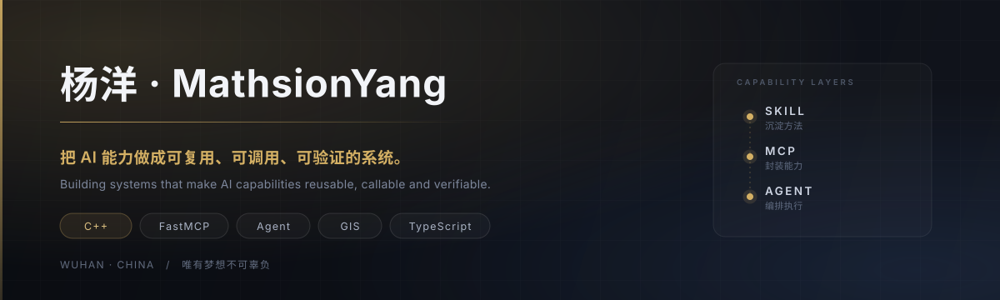
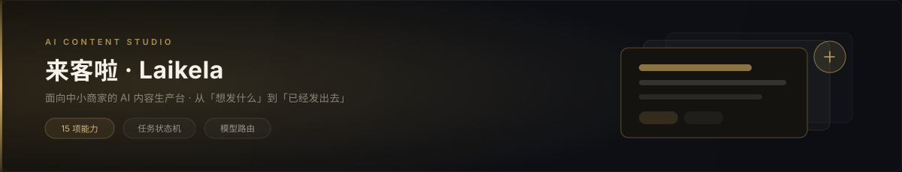
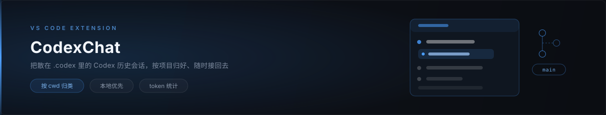
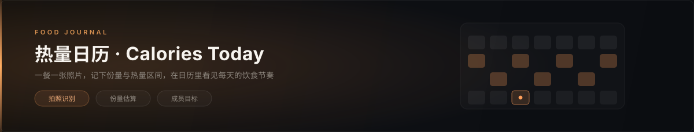
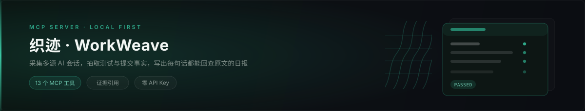

**在武汉写 C++ 和 GIS，近两年把力气挪到 Skill / MCP / Agent 的工程化上。**
**相信一项能力要被封装、被调用、被验证，才算真的存在 —— 下面每个项目都在公开里一点点长大。**

**C++ and GIS engineer based in Wuhan, now spending most of my time engineering Skill / MCP / Agent systems.**
**A capability only counts once it is packaged, callable and verifiable. Every project below is growing up in the open.**

## 🛍️ 来客啦 · Laikela

**把「想发什么」变成「已经发出去」。** 面向中小商家的一站式 AI 内容生产台，并且刻意不做聊天框套壳：15 项能力全是结构化表单，提示词按 schema 拼装，产出是可编辑的 Block 数组；长任务进队列走状态机，SSE 看实时阶段，刷新不丢进度、失败自动退积分；模型层三条路并存——平台托管 Key、租户 BYOK、任意 OpenAI 兼容端点。积分余额不存字段只存流水，`balance = sum(delta)`，扣费和界面报价共用同一个 `quoteCost()`。

**From "what should I post" to "it's already out."** An AI content studio for small businesses that is deliberately not a chat wrapper: 15 capabilities as structured forms, outputs as editable blocks, long jobs as a real state machine with SSE progress and automatic refunds, and a model layer where platform keys, tenant BYOK and any OpenAI-compatible endpoint coexist. Balances are derived from a ledger rather than a stored field, so the price on the card and the price you pay can never disagree.

## 🧵 CodexChat

**Codex 的历史会话，不该埋在 `~/.codex` 里。** 一个本地优先的 VS Code 伴生扩展：按每个会话里记录的 `cwd`，把散落的历史归回项目文件夹；只读回看对话正文，按项目汇总 token 用量；恢复会话前先看一眼当时的 Git 分支，不一致会提醒你确认。永久删除要过一次确认弹窗，删完不会让旧扫描把行又"复活"。对话内容不上传、不同步、不改写。

**Your Codex history shouldn't be buried in `~/.codex`.** A local-first VS Code companion that groups conversations by the project folder recorded in each session, reads them back read-only, and aggregates token usage per project. It shows the branch a conversation was written on and asks before continuing on a different one. Nothing is uploaded, synced or rewritten — and permanent deletion never comes back to haunt you.

## 🍽️ 热量日历 · Calories Today

**一餐一张照片，看见每天的饮食节奏。** 拍照识别食物，按少／正常／多三档调份量，记一个热量区间而不是一个假精确的数字；日历里回看每天的餐食、热量趋势和体重变化。每位家庭成员各有自己的记录和每日目标，中英文界面随时切换。识别接口可自行配置，也能用本地食物列表纯手动记 —— 不想接模型就完全不接。

**One photo per meal, and the rhythm of your day becomes visible.** Shoot the meal, pick a small, regular or large portion, and log an estimated range instead of a falsely precise number. The calendar holds the meals, the calorie trend and the weight curve, with a separate record and daily goal for each person in the house. Bring your own vision endpoint, or skip models entirely and log from the local food list.

## 🧭 织迹 · WorkWeave

**AI 干了什么，得能翻回原文对账。** 一条本地优先的多源工作痕迹管道：采集 Codex / WorkBuddy / dsh 的本地会话，去重归并、按项目与活动类别归类、从命令输出里抽取测试四态（通过／失败／阻塞／未执行）与提交事实，最后写出带证据引用的日报周报。它不内置模型、不要 API Key —— 管道只负责把事实和证据摆齐，语义总结交给你宿主自带的模型。同一项目下多个工具的会话会合并成一章，而不是按工具各写一份。

**What the AI actually did should be traceable back to the original words.** A local-first pipeline over Codex / WorkBuddy / dsh sessions: deduplicate, cluster by project and activity, extract test facts and commits from command output, then export daily or weekly reports where every claim cites its evidence. No model inside, no API key required — the pipeline stays dumb and lets your host's model do the talking. Conversations from different tools under the same project end up in one chapter, not one summary per tool.

## 📚 长期在做的事

- **把能力工程化**：专家经验封成 Skill，外部工具封成 MCP，再把两者编排成能自证的 Agent。
- **写成中文**：《AI 能力工程：从 Skill、MCP 到 Agent》系列，[开源在 GitHub](https://github.com/MathsionYang/ai-capability-engineering)，也在 [CSDN](https://blog.csdn.net/sinat_28228747?type=blog) 与 [掘金](https://juejin.cn/user/3647513603343131/posts) 连载。
- **在 GIS × Agent 的交集上做实验**：地图学与地理信息系统硕士出身，想让空间数据的取数、质检、出图也能被 Agent 稳稳接管。

**Engineering the capability layer.** Expert know-how into Skills, external tools into MCP servers, then both of them orchestrated into Agents that can prove their own work. Written up as an open Chinese book series, with side experiments where GIS meets agents.

